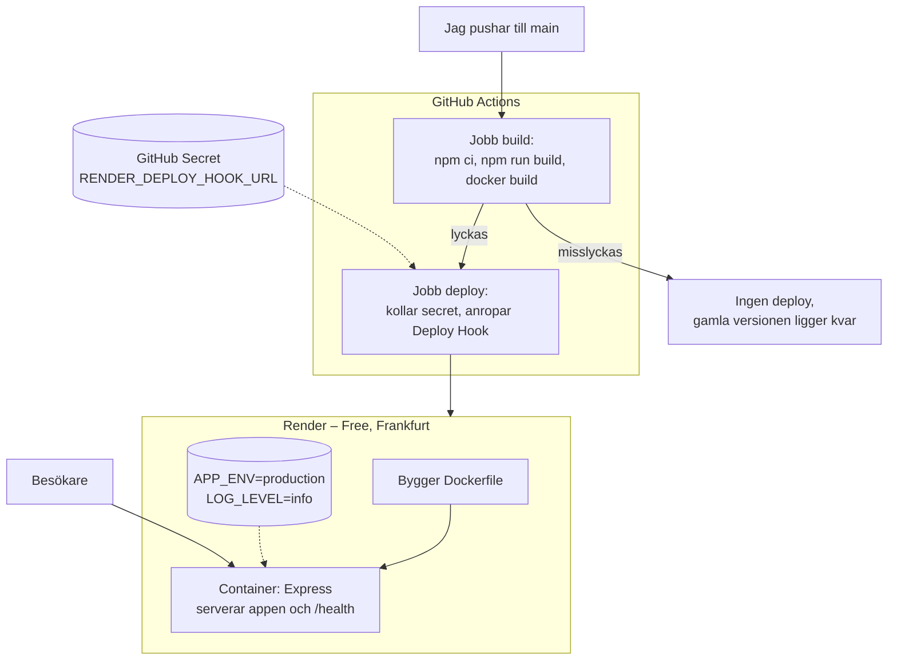

# Smajla

Appen ser till att användaren lämnar med ett leende. Startsidan frågar om man vill bli överraskad, väljer man "Yes", så tas man till sidan med slumpade meddelanden, väljer man "No", så tas man till en ledsen smiley och kan välja igen. Fokus för uppgiften var driftsättning och CI/CD så appen är enkel men med ett tydligt koncept.

Appen finns live här: https://smajla.onrender.com

## Teknik och val

Frontend är byggd med React och Vite, och animationerna gjorda med Motion. Jag valde React med Vite i stället för Next.js eftersom appen är enkel och inte behöver serverrendering, och Vite är snabbt att jobba med. Jag har också en server byggd med Node.js och Express. Servern visar React-appen för användaren, och den gör att jag själv kan bestämma hur loggning, felhantering och health check ska fungera.

Från början hade jag frontend och backend som två separata projekt med var sitt package.json. Men jag slog ihop dem till ett, eftersom det blev enklare att bara ha en container, en installation och en pipeline. Koden ligger fortfarande i olika mappar så att det är lätt att hålla isär.

Appen körs i en Docker-container. Den byggs och kontrolleras med GitHub Actions, och den ligger på Render.

## Arkitektur



## Köra appen lokalt

Man behöver Node.js 22. Installera och skapa en egen .env-fil från exemplet:

```
npm install
copy .env.example .env
```

För att utveckla startar man frontend och server i varsin terminal:

```
npm run dev
npm run dev:server
```

För att testa som i produktion bygger man appen först och startar sedan servern:

```
npm run build
npm start
```

Skillnaden är att i utvecklingsläge körs appen direkt från koden och sidan uppdateras automatiskt när jag sparar. I produktion byggs appen först till färdiga, optimerade filer i mappen dist, och det är de filerna som servern sedan visar.

## Docker

Appen kan köras i Docker med:

```
docker build -t smajla .
docker run --rm -p 3000:3000 smajla
```

Dockerfilen bygger i två steg. I första steget installeras allt och appen byggs. I andra steget tas bara det med som behövs för att köra appen, alltså servern och de färdiga filerna. Verktygen som bara behövdes för att bygga följer inte med. Det gör att imagen blir mindre och snabbare att ladda upp.

Containern körs dessutom inte som administratör (root), utan som en vanlig användare. Det är säkrare, för om någon skulle ta sig in kan den inte göra lika mycket. Jag har också en .dockerignore-fil som gör att till exempel .env och node_modules aldrig kommer med in i imagen.

## Miljövariabler och hemligheter

Appen använder tre miljövariabler:

- PORT, alltså vilken port servern körs på. Lokalt är det 3000, och på Render sätts den automatiskt.
- APP_ENV, alltså vilken miljö appen körs i. Lokalt är det development, och på Render production.
- LOG_LEVEL, alltså hur mycket som loggas. Lokalt använder jag debug, som visar mycket, för att lättare hitta fel. På Render använder jag info, så att loggarna inte blir för fulla.

Koden är alltså samma överallt, och det är bara inställningarna som skiljer sig.

Det enda hemliga i projektet är länken (deploy hook) som säger åt Render att starta en ny deploy. Den ligger som en secret i GitHub och finns inte någonstans i koden. Min .env-fil laddas aldrig upp till GitHub, eftersom den står i .gitignore. Bara en exempelfil utan riktiga värden finns med. Om deploy hooken skulle läcka skulle någon bara starta en ny deploy av koden som redan finns, inte ändra något. Om det hände så skulle jag skapa en ny länk i Render och byta ut den i GitHub.

## Loggning och felhantering

Servern loggar när den startar, varje gång någon besöker sidan, när något går fel och när den stängs ner. Varje logg skrivs som en rad i JSON-format, med tid, nivå, miljö och vad som hände. Det gör loggarna lätta att läsa och söka i, till exempel i Render.

Om något går fel ser användaren bara meddelandet "Internal Server Error", medan hela felet med detaljer bara syns i loggarna. Det är för att inte visa information om koden för utomstående. På adressen /error-test skapas ett fel med flit, så att man kan se att det fungerar.

Adressen /health visar om servern lever, vilken miljö den körs i och hur länge den har varit igång. Render använder den för att kontrollera att appen fungerar. Om något går fel kan jag först kolla /health för att se om servern lever, och sedan söka efter error i loggarna i Render för att se vad som hände.

## Ett problem jag löste

När Render ska starta om appen skickar den en signal (SIGTERM) som säger åt servern att stänga ner. När jag testade det lokalt med docker stop stängdes servern inte som den skulle. Det visade sig att webbläsaren höll en anslutning öppen till servern, och då väntade servern på den. Jag löste det genom att servern först stänger alla anslutningar som inte används, och om några finns kvar efter 3 sekunder tvingas de att stänga.

## CI/CD med GitHub Actions

Varje gång jag pushar till main startar en pipeline i GitHub Actions. Den har två delar:

- Build installerar allt, bygger appen och bygger Docker-imagen. Det är för att kontrollera att allt faktiskt går att bygga.
- Deploy körs bara om build lyckades. Den kollar först att hemligheten finns och skickar sedan en signal till Render om att deploya den nya versionen.

Om bygget misslyckas körs aldrig deploy. Det betyder att en trasig version aldrig kommer ut, och den gamla versionen på Render fortsätter fungera tills jag har fixat felet.

Pipelinen har bara rätt att läsa koden, inte ändra den.

## Render

Appen körs på Render som en Web Service med Docker, med gratisplanen. Jag har stängt av automatisk deploy i Render, så Render deployar bara när GitHub Actions säger till. På så sätt deployas bara kod som har klarat bygget.

## Hur jag testade att allt fungerar

- Första gången jag pushade hade jag inte lagt in deploy hook än för att jag inte hade driftsatt på Render än, och då misslyckades deploy med ett tydligt felmeddelande. Det visade att kontrollen fungerar.
- Efter jag lagt upp på Render och fått deploy hook, så ändrade jag titeln på sidan och pushade igen. Pipelinen blev grön och ändringen syntes på den riktiga sidan.
- Jag lade in ett fel i koden med flit. Vilket gjorde att build misslyckades, deploy kördes inte och sidan på Render var oförändrad.
- I Render kunde jag se loggarna, både de vanliga och felet från /error-test.

Skärmdumpar i inlämningen.

## Kostnad

Jag använder Renders gratisplan. Det är en skoluppgift med väldigt lite trafik, och appen behöver inte vara igång hela tiden, så det finns ingen anledning att betala.

Det som påverkar kostnaden är framför allt hur stor servern är (hur mycket CPU och minne den har), hur många timmar den är igång och hur många servrar man har. Trafik, byggtid och extra tjänster som databaser kostar också.

Jag har försökt hålla nere resurserna genom att bara ta med det som behövs i Docker-imagen, använda en liten grundimage, logga mindre i produktion och bara ladda de typsnitt som faktiskt används.

Nackdelen med gratisplanen är att appen somnar efter 15 minuter utan besökare och tar ungefär en minut att vakna. Det finns också bara en server, så om den går ner är sidan nere. För en skoluppgift spelar det ingen roll, men för en riktig tjänst med användare skulle det vara mindre bra.

Om appen fick många fler användare skulle jag behöva en betalplan där appen alltid är igång. Jag skulle kunna välja en större server eller flera servrar som delar på trafiken. Jag skulle också vilja ha övervakning som larmar om något går fel, och en testmiljö där man kan prova ändringar innan de går ut.

## Vad jag lärde mig

Det mest lärorika var att felsöka varför servern inte stängdes, och att testa pipelinen genom att göra fel med flit. Då såg jag att skydden faktiskt fungerar och inte bara står i koden.

Med mer tid skulle jag lägga till automatiska tester i pipelinen, en testmiljö, och göra så att /health-anropen inte fyller loggarna eftersom Render kollar den var femte sekund. Jag skulle också bygga ut appen med fler och större överraskningar.
